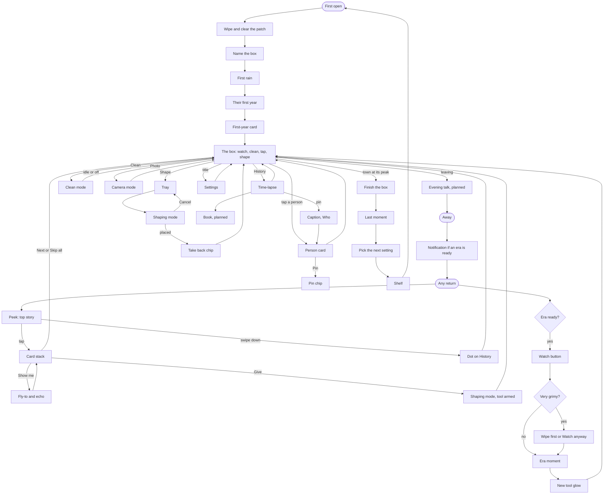

# UI inventory (#105, first pass, 2026-10-31)

Every UI piece in the slice: what the player deals with, where each thing appears, what exists today, and how the
pieces connect. It feeds the hierarchy and wireframes (#163) and the UI rework epic (#103).

**Sources:** the design docs, the open issues, the "Note for the UI rework" comments, and the code on `vs/slice` at
7851231 (element names, buttons and toasts pulled from the source).
**Captures:** one image per state in [ui/captures/](ui/captures/README.md), which also lists the bugs they show.

Status: **built** = works, in the plain #36 style. **part** = works with parts missing. **none** = not built.
Serves: **P** player, **T** tester (test builds), **D** developer.

---

## 1. Objects: what the player cares about

| Object | Shows (attributes) | Player can | Linked to |
|---|---|---|---|
| **Box** | Name, year, era, setting, plate text | Name it, rename it, finish it, visit it on the shelf | Everything; era, people, relics |
| **Person** (notable) | Name, portrait, job, role, trait, age, family, friends, rivals, stories, legend reasons | Tap, pin, follow, see on the map through ties | Stories, wishes, teasers, roles, book legends |
| **Person** (crowd) | Today nothing; #148 gives a small card | Tap (#148) | Notables, the day's activity |
| **Story** (chronicle entry or card) | Kind, tone, headline, body, quote, year, salience, who, where | Read, Show me, skip, remember, recall | People, era, pins, book pages, teasers |
| **Teaser** | One line said at the close | Hear it, see it again on the payoff card | A story thread |
| **Wish** | Who wants what, where | Give, cancel, ignore | Person, tool, a spot in the world |
| **Tool** (gift or landscaping) | Name, icon, charges, lock, cap, footprint | Pick, place, cancel | Shaping, wishes, era unlocks |
| **Shaping** (a placed tool) | Where, who answered, can it be taken back | Take back while unused | Tool, story, the people's answer |
| **Relic** | Name, prop, hint while unfound | Find, see in the book, see on a plinth | Era, people, shelf |
| **Era** | Name, title, years, ready or waiting | Watch, delay | Moments, tools, book spreads, time-lapse bands |
| **Mess and glass** | Grime, trash, weeds, how clean | Wipe, flick, clean | Care, people's reactions, Clean button |
| **Book page** | Kind, era look, fixed once earned | Turn, jump to person or story | Era, people, relics |

---

## 2. Connections: object × surface

Where each object appears, and what it shows there. This is the map for "the same thing must look the same"
(practices §1).

| Object | World | HUD | Person card | Cards and peek | Time-lapse | Book (planned) | Moments | Tray | Shelf |
|---|---|---|---|---|---|---|---|---|---|
| **Box** | The box itself, brass plate | Name + year | | | Year line | Cover | Captions | | Plate, list |
| **Person** | Doll, marker, gold pin tag, tie lines | Pin chip | Everything | Portrait (initials today), name | Pin's person ("Who") | Legends, family trees | Speaker | Wish credit | Roll call |
| **Story** | Show me echo, bubble | History dot | Best, Recent | The card itself | Pins, caption | Era events | | | |
| **Teaser** | Speaker at the fire (none yet) | | | Line above the headline | | | | | |
| **Wish** | Bubble, spot | | | Wish card | | | | Wish bar, armed tool | |
| **Tool** | Footprint, placed thing | Shape | | Give | | | New tool glow | Row, pips | |
| **Shaping** | The thing, Take back chip | | | Payoff story | | | | Take back | |
| **Relic** | Prop, nudge | | | Card | | Page, silhouette | Find moment | | Plinth |
| **Era** | The rebuild | Year only | | Last card, Watch | Bands, era card | Spreads | Everything | Tool unlock | Plate line |
| **Mess** | Grime, trash, weeds | Clean | | | Clean glass, on purpose | | Wipe hint | | Per-box grime |

Three things this shows:
- **A person appears on nine surfaces.** It's the object most in need of one shared look.
- **Era has no always-on sign in the HUD.** That may be right (pillar 5). #163 should decide it on purpose.
- **Story has two homes** (the stack and the time-lapse). The History button today means both, which is the "Skip all
  and History" bug in open-questions.md.

---

## 3. Surfaces

### 3.1 Always there
| Piece | Purpose | Where | States | Serves | Code | Issue | Status |
|---|---|---|---|---|---|---|---|
| Title pill | Box name + year, opens Settings | Top centre | Default name, named, hidden | P | `hud-title` | #36 | built |
| History button | Opens the stack or the time-lapse | Bottom left | Default, unread dot, hidden | P | `hud-history`, `-dot` | #36, #79 | built |
| Pin chip | The pinned person | Bottom row | Hidden, pinned | P | `hud-pin` | #39 | built, **must change** (#136) |
| Clean button | Clean mode | Bottom row | Off, on, auto-off after idle | P | `hud-clean` | one-handed doc | built |
| Shape button | Opens the tray | Bottom right | Default, new-tool glow (planned), hidden | P | `hud-shape` | #84 | built |
| Photo button | Camera mode | Top right | Default | P | `hud-photo` | #70 | built |
| Show the UI pill | Leaves camera mode | Bottom | Camera mode only | P | `hud-photo-exit` | #70 | built |
| Feedback button | Send a note | Top right | Test builds only | T | `hud-feedback` | #55 | built |
| Debug dock | Cheats | Screen edge | Dev only, stays IMGUI | D | `DebugDock`, `SliceDebugPanel`, `SimDebugPanel` | | built, kept apart |

### 3.2 In the world
| Piece | Purpose | Where | States | Serves | Code | Issue | Status |
|---|---|---|---|---|---|---|---|
| Ambient bubble | The people speak | Over the speaker | One at a time, rate limited | P | `WorldBubbles`, `showme-bubble` | #76, #143, #144 | part |
| Name tag, pin tag | Who is open or pinned | Over the person | Card open, pinned gold; no always-on marker | P | `pc-name-tag`, `pc-pin-tag` | #39 | built |
| Tie lines | Friends, family, rivals | Between people | Colour per tie | P | `ColorOf(TieKind)` | #39 | built |
| Take back chip | Undo a shaping | Near the shaping | Visible, then gone (#149 timer) | P | `shaping-takeback-` | #84, #149 | built |
| Footprint | Where a tool lands | Under the finger | No preview today; only the wish's "Here" pin | P | `ShapingFootprint` (core only) | #84 | none |
| Brass plate | The box's name | On the plinth | Blank, named, second line | P | `firstrun-plate`, `visit-plate`, `ShelfProps` | #94 | part |

### 3.3 The return
| Piece | Purpose | Where | States | Serves | Code | Issue | Status |
|---|---|---|---|---|---|---|---|
| Peek | One line, what happened | Bottom | Shown, dismissed, dot | P | `cards-peek` | #75 | built |
| Card stack | Stories since you left | Bottom sheet | Story, wish, era, relic, legend, Keeper, teaser line, end line, last page | P | `cards-sheet` | #75 | built |
| Also… card | The overflow | Last in stack | 1–3 headlines | P | `cards-also` | #75 | built |
| Show me | Fly to a story | World + card | Running, cannot go there | P | `ShowMeDirector` | #76 | built |
| Recall prompt | Day-3 research question | Sheet | Asked, answered, Not now | T | `recall-sheet` | #100 | built |

### 3.4 Acting on the box
| Piece | Purpose | Where | States | Serves | Code | Issue | Status |
|---|---|---|---|---|---|---|---|
| Person card | Who this is | Lower sheet | Notable, no stories, legend, pinned, Best or Recent | P | `person-card` | #39, #148 | built, crowd none |
| Shaping tray | Pick a tool | Sheet | Tools, charges, locked, capped, empty, Take back list | P | `shaping-tray`, `-tools`, `-pips` | #84 | built, landscaping row is a note |
| Shaping mode | Place a tool | Banner + Cancel | Armed, wish-armed, placed, refused | P | `shaping-banner`, `-cancel`, `-wish-bar` | #84, #145 | built |
| Clean mode | Wipe | Glass | On, idle off, spotless | P | `CareView` | one-handed doc | built |

### 3.5 History
| Piece | Purpose | Where | States | Serves | Code | Issue | Status |
|---|---|---|---|---|---|---|---|
| Time-lapse screen | The box's life | Full screen | Playing, paused, empty, at a pin | P | `tl-root`, `tl-panel` | #79 | part: no fly to pin, gold band or share |
| Era card | Era at a marker | Over the world | About 1 s | P | `tl-era-card` | #79 | built |
| Pin caption | A story at a year | Above timeline | With or without a person | P | `tl-caption` | #79 | built |
| Snapshot label | Name on a saved image | In the image | | P | `TimeLapseSnapshot` | #79 | built |
| Book and book tab | The keepsake | Full screen | Each page kind, ribbon on new pages, silhouettes | P | | #80 | none |

### 3.6 The big moments and the close
| Piece | Purpose | Where | States | Serves | Code | Issue | Status |
|---|---|---|---|---|---|---|---|
| Evening talk | How a check-in ends | World + caption | Gather, speak, shelf view | P | | #77 | none |
| Era-ready and Watch | The era waits | Thumb zone | Hidden, ready, wipe first | P | `moment-watch` | #86 on | built |
| Moment overlays | Era moment | World | Hold-to-hurry, bubble, caption | P | `moment-root`, `-hint`, `-caption`, `-bubble` | #88 on | built |
| Notification ask | Opt-in | Prompt | Yes, Not now; scheduling not built | P | `moment-notify` | #97 | part |
| Finish the box | Starts the end | Thumb zone | Hidden, ready | P | `complete-prompt` | #87 | built |
| Last moment | The end | World | Bubble, caption, hint, roll call | P | `boxcomplete-*` | #87 | built |
| Setting picker | Choose the next box | | No UI: only debug sets it | P | `SettingForNextBox` | #115 | none |
| Shelf | Finished boxes | Sheet + world | List, open, visiting (banner + plate) | P | `shelf-*`, `visit-*` | #87 | built |

### 3.7 First run
| Piece | Purpose | Where | States | Serves | Code | Issue | Status |
|---|---|---|---|---|---|---|---|
| Gesture hints | Teach by doing | World + word | Ghost finger, repeat at most 3 times | P | `firstrun-hint`, `-ghost` | #94 | built |
| Naming sheet | Name the box | Sheet | Suggested, invalid, Another, Later, Keep | P | `firstrun-name-*` | #94 | built |
| First rain | First gift | Button | | P | `firstrun-rain` | #94 | built |
| Their first year | Years passing | Bar + caption | Running | P | `firstrun-year*` | #94 | built |
| First-year card | First stories | Card | Show me, Done, Also | P | `firstrun-card-*` | #94 | built |
| Skip row | Skip for testers | Corner | Step, all | T | `firstrun-skip-*` | #94 | built |

### 3.8 Settings and feedback
| Piece | Purpose | Where | States | Serves | Code | Issue | Status |
|---|---|---|---|---|---|---|---|
| Settings sheet | Options | Sheet | Sound, haptics, version today | P | `settings-*` | #95 | part |
| History sheet (first run) | Placeholder before the first year | Sheet | Text only | P | `GameHud.BuildHistory` | #79 | built |
| Volumes, music | Three sliders + frequency | Settings | Silent phone notice | P | `GameSettings` has them, no UI | #95 | none |
| Rename, reset, licences | Box and legal | Settings | Reset confirm | P | | #95 | none |
| Feedback sheet | Send a note | Sheet | Kind, text, screenshot, sent, queued | T | `fb-sheet` | #55, #153 | built |

---

## 4. Duplicates to merge

The same idea has been built more than once. These become single components in #108.

| Component | Built today as | Count |
|---|---|---|
| **Speech bubble** | `firstrun-bubble`, `moment-bubble`, `showme-bubble`, `shaping-bubble`, `boxcomplete-bubble` | 5 |
| **Toast** | `hud-toast`, `tl-toast`, `fb-toast` | 3 |
| **Card** | Chronicle card, person card, first-year card, recall card, feedback card | 5 |
| **Sheet + scrim** | `GameHud.Sheet`, `cards-sheet`, `recall-sheet`, `shelf-sheet`, `fb-sheet`, naming sheet | 6 |
| **Caption** | `moment-caption`, `boxcomplete-caption`, `firstrun-year-caption`, `tl-caption` | 4 |
| **Hint** | `firstrun-hint`, `moment-hint`, `boxcomplete-hint` | 3 |
| **Banner** | `shaping-banner`, `visit-banner` | 2 |
| **Big prompt** | `moment-watch`, `complete-prompt`, `firstrun-rain` | 3 |

Screens already share lanes for prompts and toasts (`GameUiPanel.PromptBottom`, `ToastBottom`), so that rule carries
over. Audio cues exist (`Sfx`, `CueLibrary`): components should call them by role (tap, open, close, toggle).

---

## 5. Flow map

**Odd paths #163 must draw:**
- The app is closed mid-flow: during a sheet, in shaping mode, in an era moment, during naming.
- Nothing to show on return, and a very long absence.
- Skip all, then History (known bug).
- Wish Give, then Cancel (known bug: the card and dot vanish).
- Two prompts at once: Watch with a toast, Watch with a wish, era ready during the first run.
- A person's card open when that person is off camera or dead.
- Camera mode while a moment becomes ready.

---

## 6. Docs against code

**In the code, missing from the UI tables in the design docs:**
Clean button, Photo and its exit pill, toasts, the recall prompt, shelf list and visiting banner, Finish the box,
setting picker, first-run skip row and year bar, person card tabs (Best, Recent), time-lapse speed and caption
navigation, the wish bar, tie lines.

**In the docs, not in the code:**
Evening talk, book and book tab, notification ask, rename, reset, licences, volumes in settings, card art per kind,
real portraits (initials today), gold life band, fly to a pin, share, landscaping row in the tray.

**Docs that disagree with the code:**
- `first-session-and-check-in.md` §6 lists the bottom row without Clean.
- `chronicle-and-history.md` §7 puts the stack at ≤ 30 % of the height. The tray takes 60–80 % and the time-lapse
  caption about 45 % (open-questions.md). `PersonCardView.CardMaxShare` is 0.46.
- `docs/README.md` still says the Clean button isn't built.
- #95 says Feedback lives in settings; it's in both settings and the HUD corner.
- The `GameHud` class comment doesn't mention Clean or Photo.

---

## 7. Open feedback that touches this list

| From | What | Goes to |
|---|---|---|
| #136 | The pin chip must change | #163 and #107 |
| #143, #144 | Bubbles: don't cover the speaker, show who talks, stay long enough; chatter symbols | Bubble component |
| #145 | Rain drops with a tap; moving the camera never places a tool | Shaping mode |
| #148 | Crowd people get a small card | #165 |
| #149 | Take back chip disappears after a timer | #167 |
| #153 | Feedback screenshots keep the HUD | Feedback sheet |
| #156 | Cleaning weeds on return is confusing | Clean mode, hints |
| open-questions.md | Two years on the time-lapse, targets under 44 pt, faint grey text, toast behind the sheet, "Next 1/7" | #163 |

---

## 8. Moments for #163

Rank each piece per moment: **first run, glance, check-in, close, era moment, history.** Pieces marked T or D in §3
should never compete with P pieces, but today Feedback sits in the same corner and at the same size as Photo.
